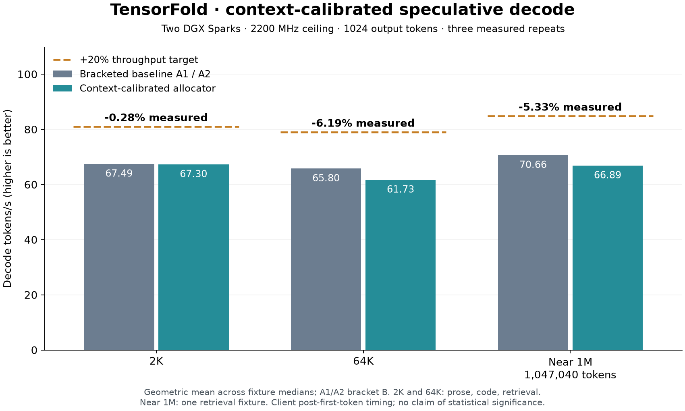
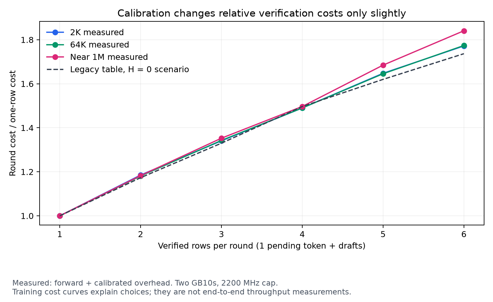

# Context-calibrated speculative allocation on two DGX Sparks

The change adds opt-in speculative-decode timing and context/stream-count cost
profiles. This receipt compares the calibrated allocator against the previously
qualified FP4-prefill branch, using the same checkpoint, CUDA kernels and serving
configuration. **The 20% decode-throughput target was not met.**

The original service was restored on both hosts after the experiment. Both GPUs
were capped at 2200 MHz; the maximum observed SM clocks were
2190 / 2190 MHz, with
0 ceiling violations in
900 paired telemetry samples. See [clock-summary.json](clock-summary.json).

## Measured decode performance

| Input context | Bracketed baseline tok/s | Candidate tok/s | Change | A2 vs A1 drift |
|---|---:|---:|---:|---:|
| 2K (2,048) | 67.49 | 67.30 | -0.28% | -0.02% |
| 64K (65,536) | 65.80 | 61.73 | -6.19% | +0.08% |
| Near 1M (1,047,040) | 70.66 | 66.89 | -5.33% | +0.17% |

For each fixture, take the median of three measured requests. Its baseline is the
arithmetic mean of A1 and A2 medians, with candidate B between them. Context TPS
are geometric means across fixture values, so their ratio gives an equal-weight
workload speedup. A 20% throughput gain requires 16.67% less time for identical
work. Three repetitions are descriptive measurements, not a confidence interval.



| Workload | A1 tok/s | B tok/s | A2 tok/s | B vs bracketed baseline |
|---|---:|---:|---:|---:|
| 2K (2,048) / prose | 56.50 | 56.81 | 56.48 | +0.56% |
| 2K (2,048) / code | 81.48 | 80.36 | 81.50 | -1.39% |
| 2K (2,048) / retrieval | 66.80 | 66.78 | 66.78 | -0.01% |
| 64K (65,536) / prose | 58.34 | 52.50 | 58.41 | -10.06% |
| 64K (65,536) / code | 71.80 | 72.12 | 71.87 | +0.39% |
| 64K (65,536) / retrieval | 67.91 | 62.12 | 67.95 | -8.56% |
| Near 1M (1,047,040) / retrieval | 70.60 | 66.89 | 70.72 | -5.33% |

The primary measurement is client `(1024-1)/(last text arrival-first text arrival)`.
Prefill and TTFT are excluded. Full arrival traces, all repetitions and observed
ranges are retained. Server request-completion and first-to-last token timings
are separately reported in [summary.json](summary.json), where available.
These are end-to-end service measurements, not GPU-only timings.

Plain-decode controls use one request per fixture per phase and are diagnostic,
not part of the speculative-speed average:

| Workload | A1 plain tok/s | B plain tok/s | A2 plain tok/s | B vs bracketed plain baseline |
|---|---:|---:|---:|---:|
| 2K (2,048) / prose | 44.23 | 43.96 | 44.20 | -0.58% |
| 2K (2,048) / code | 44.24 | 44.19 | 44.25 | -0.12% |
| 2K (2,048) / retrieval | 44.21 | 44.21 | 44.23 | -0.03% |
| 64K (65,536) / prose | 44.08 | 39.46 | 44.09 | -10.48% |
| 64K (65,536) / code | 44.01 | 39.20 | 44.06 | -10.98% |
| 64K (65,536) / retrieval | 44.12 | 39.29 | 44.08 | -10.92% |
| Near 1M (1,047,040) / retrieval | 41.34 | 39.51 | 41.26 | -4.33% |

The 64K prose candidate showed a slowdown in both modes, with essentially the same
verification-round and accepted-draft counts as A1. That does not establish an
allocator-specific cause. This experiment compares the complete candidate build
against the prior qualified build; an isolated catalog-off/on comparison in the
same binary is reported below. The main comparison
alone cannot separate catalog effects from a shared binary path or runtime
conditions. [policy-diagnostics.json](policy-diagnostics.json) retains
the draft/acceptance/round counters. The data do not justify promoting this change
as a performance win.

The near-1M first request also exposes a prefill discrepancy, retained here as a
diagnostic rather than included in the decode score:

| Phase | Near-1M first-request TTFT, seconds | Reported cached tokens |
|---|---:|---:|
| A1 | 508.96 | 0 |
| B | 678.72 | 0 |
| A2 | 508.75 | 0 |

## Same-binary catalog-off/on diagnostic

After restoring the main run, a separate bounded control tested only the frozen
64K prose fixture. C0 and C1 use identical new native binaries and the same FP4
catalog on both nodes, with tracing/sweep off; only the cost catalog setting changes.
Each phase has one warmup, three speculative repetitions and one plain reference.

| Phase | Median speculative tok/s | Single plain-control tok/s |
|---|---:|---:|
| C0 / catalog off | 58.34 | 44.12 |
| C1 / catalog on | 58.39 | 44.08 |

Catalog-on relative to catalog-off: +0.09%
speculative throughput and -0.08% in the
single plain control. All ten full outputs match A1 plain. The original service
was restored again; 74 additional paired clock samples
contain 0 cap violations.
See [control-summary.json](control-summary.json) and
[control-clock-summary.json](control-clock-summary.json).

The earlier 64K slowdown did not reproduce in this short control. The catalog
switch has a negligible measured effect here; the cause of the earlier shared
slowdown remains unresolved, and there is no evidence of a 20% gain.

This sequential two-phase diagnostic is not a replacement for the three-context
A1/B/A2 experiment or a confidence interval. It only isolates the catalog switch
within one new binary at 64K prose; it does not establish performance at 2K or
near 1M. The earlier candidate's shared plain/speculative slowdown remains part
of the main results and is not removed from their averages.


## Output preservation and scope

- 98/98 non-self full-token-ID comparisons matched the A1 plain references, across 105 main requests.
- Near-1M sampled plain/speculative equality: True (128 outputs, temperature 0.7, seed 1234).
- Lifecycle checks passed: True; covers 2K solo/concurrent greedy and sampled output, 64K sampled output, prefill/decode cancellation recovery, and fresh/replayed prefixes.
- Candidate synthetic retrieval: 2K (2,048): 3/3; 64K (65,536): 3/3; Near 1M (1,047,040): 3/3. Repetitions are not counted as new independent records.

These checks establish preservation of the existing FP4 engine's outputs on this
test set. They do not measure broad model quality or compare against FP8 weights.
The 2K/64K speed sets contain prose, code and retrieval; near 1M contains only one
retrieval fixture. Sampled coverage uses one seed. Two-stream lifecycle checks
exercise the unchanged fallback because this catalog calibrates single-stream
decode only. The normal 4096-token retention threshold makes 2K retained-prefix
testing inapplicable; 64K retention is verified explicitly.

## Calibration and activation

| Inclusive context band | F(1) ms | F(2) ms | F(3) ms | F(4) ms | F(5) ms | F(6) ms | Residual H ms |
|---|---:|---:|---:|---:|---:|---:|---:|
| 2,048–4,096 | 22.378 | 27.193 | 31.237 | 35.120 | 39.212 | 42.444 | 3.618 |
| 65,536–67,584 | 22.490 | 27.220 | 31.435 | 35.285 | 39.347 | 42.697 | 3.622 |
| 1,047,040–1,048,576 | 23.903 | 28.940 | 33.617 | 37.586 | 42.759 | 47.059 | 3.636 |

The legacy row costs are 30, 35.2, 39.9, 44.9, 48.6 and 52.1 ms. Fitting uses
separate training prose and a K=0…5 sweep, discarding request/shape warmup and
bucket-transition samples. F is measured verification completion time; H is the
adjacent-round residual, including draft and host/scheduling work. At least five
samples per row and for H are required. Profiles are not extrapolated into gaps,
unmeasured concurrency or proposals crossing a band boundary.
Each band assumes costs stay constant within its declared range; calibration
samples only the named starting context and its 1024-token generation trajectory.
It does not establish performance at every interior context or on every workload.

Measured allocation decisions are mixed. The 2K code candidate required 320 rounds
versus 313/312 in A1/A2; near-1M retrieval required 340 versus 331/331. Other cases
saved a few rounds or stayed unchanged. Minimizing expected cost from confidence
estimates and a training-average table is not a guarantee of fewer actual rounds
or faster held-out decode. These are actual attributed counters, distinct from
the training replay estimate below.



The relative row costs stay close to the legacy curve. Training replay therefore
predicts less than 1% benefit from changing allocation alone. That replay is a
counterfactual under measured costs, not measured throughput. Its legacy overhead
0 ms and 8 ms inputs are scenarios, not recorded baseline runtime overhead.
The live training trace has all request release records and reconciles with
reported verification-round counts; no shutdown summary is expected in this
pre-shutdown copy. See [trace-validation.json](trace-validation.json).

Candidate activation was independently checked on both hosts. The deployed
cost catalog SHA256 is `9ffaf78d07fb4d043715e05f51e8efad42fd5ad4eba7d8f43a60a9f82bdc270f`. `TF_DS_SPEC_COSTS` is set;
`TF_DS_SPEC_TRACE` and `TF_DS_SPEC_SWEEP` are unset during B. Native FP4 indexing,
exact top-K, CUDA graphs, HC side-stream, L2 prefetch and Engram AIO remain enabled.
See [B-activation.json](B-activation.json). All three new controls default off.

## Reproduction and qualification

- Baseline source: `6af4fd8a083323644651f65397f21ca61b4cdd2f`.
- Instrumented binary source: `bd6fa1255bb1a9f37cedb045d770b5f94207c3df`. Later commits contain receipts/documentation only.
- Checkpoint: `Mia-AiLab/DeepSeek-V4.1-Flash-1017-EXL3-EAQ-v1-2.9-bpw`, revision `45ee5d0fd106c94a3d77f721e09cbb2f50e5a16b`.
- Two NVIDIA GB10 GPUs, TP2 over the existing dual-rail RDMA configuration; 1,048,576-token pool, two stream slots.
- Fixed token arrays: train seed 2468, held-out seed 7391. Every main request uses 1024 outputs, temperature 0, seed 1234, ignore-EOS and thinking disabled.
- One speculative warmup, three speculative measurements and one plain reference per fixture per phase. Order: calibration, A1, B, lifecycle, A2. Long repeated prompts use retained prefixes; the decode target excludes prefill.
- Host build/tests: 21/21 build steps succeeded, 237 executed tests passed plus seven cached; release build 8/8 steps succeeded. A prior timing-sensitive keepalive test failed under parallel compilation, then passed in the serialized final run.
- Python calibration/benchmark checks: 31 passed. Summary self-tests validate aggregation, matrix completeness, full IDs, metrics and rejection of incomplete evidence. Lean check: 1490 findings before and after, zero added findings. No CUDA arithmetic changed.
- Device qualification here is limited to these two SM121 GB10s. Metal, other GPU platforms, and the separate golden-server corpus were not run; this is not a cross-platform release qualification.

Use [the calibration tools](../../../tools/dsv41-zig/spec_calibration/README.md)
to generate fixtures, fit profiles and run individual requests. The frozen fixtures,
full output IDs, timings, counters and training trace are included as gzip files.
Decompress `receipt.json.gz` and run:

```sh
python3 summarize.py --receipt receipt.json --output recomputed-summary.json
python3 summarize.py --self-test
```

The raw controller's older `speed` field uses pooled medians and is retained only
as raw evidence. Use `summary.json` and the per-fixture table above for conclusions.
Clock host names and build-log home paths are anonymized; numerical evidence is
unchanged. [SHA256SUMS](SHA256SUMS) covers all public receipt files.

## Next optimization with a plausible larger budget

First reproduce the full-sequence slowdown with phase timing and memory-traffic
measurements before attributing another performance change to the allocator.
The next kernel measurement should isolate verification at row counts 1–6 while
preserving the graph/PDL execution path. EXL3 dense scheduling currently targets
192 CTAs without independently tuning these small row counts. Measure actual
DRAM traffic and kernel time before specializing physical scheduling, staging and
register use; preserve the reduction order and quantized arithmetic.

A separate prototype could fuse RDMA collect with HC postprocessing and let
producer epilogues publish directly into registered buffers. Its payoff is not
yet measured. For a representative 33.39 ms round, 20% faster throughput requires
5.56 ms saved; across 80 boundaries that is about 69.6 microseconds each. Saving
10 microseconds per boundary would provide only about 2.45%, so this is not an
evidence-backed promise of a 20% win. DeepInfer's native FP4 MoE also requires a
different weight format and is not an exact replacement for the served EXL3 model.
