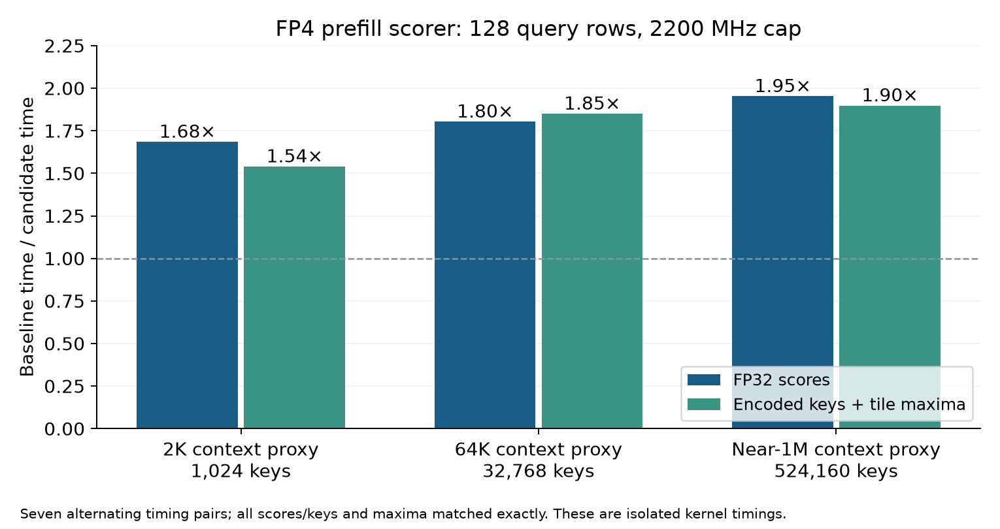

# FP4 prefill loading and key reuse on two DGX Sparks

The TREE prefill scorer loads packed keys in vectors, retains key MMA fragments across query
rows, and performs the original FP32 head-reduction tree with warp shuffles. It removes the
shared score matrix and skips QK for fully invisible tiles. This comparison isolates the
prefill change against the immediately preceding native-FP4 + exact-top-k implementation.
The shared scratch structure shrinks from 16,384 to 6,688 bytes per block.
The native server binaries, decode kernels, model weights and cache format are unchanged.

## Full-model measurements

Near-1M cold TTFT falls from 503.498 to 473.550 seconds (5.95% lower; 6.32% higher
context/TTFT throughput). Baseline drift is 0.45%. The 2K/64K TTFT differences are under
0.6% and comparable with drift, so this run does not establish a useful short-context gain.
Plain decode differs by less than 0.3%; speculative decode at 64K measured 1.19% lower.
No decode improvement is claimed. The near-1M result is one fixture per phase.

Baseline A1, candidate B, baseline A2 ran sequentially on the same two Sparks. Short-context
cells are medians of three synthetic fixtures; near 1M uses one fixture per phase. Every
request generated 128 tokens at temperature 0 and seed 1234, with thinking disabled and EOS
ignored. The cold request uses speculation; the immediate plain-decode repeat's cache state
is retained in the raw receipt. Cold requests require zero cached tokens. These are descriptive
measurements, not confidence intervals. Compare the improvement with the reported baseline drift.

Cold time to first token (lower is better):

| Prompt tokens | A1 (s) | Candidate (s) | A2 (s) | Candidate vs mean baseline | A2/A1 drift |
| --- | ---: | ---: | ---: | ---: | ---: |
| 2,048 | 1.132 | 1.137 | 1.135 | +0.29% | +0.26% |
| 65,536 | 27.835 | 27.753 | 27.965 | -0.52% | +0.47% |
| 1,048,320 | 502.374 | 473.550 | 504.621 | -5.95% | +0.45% |

Plain decode (higher is better):

| Prompt tokens | A1 (tokens/s) | Candidate (tokens/s) | A2 (tokens/s) | Candidate vs mean baseline | A2/A1 drift |
| --- | ---: | ---: | ---: | ---: | ---: |
| 2,048 | 44.366 | 44.196 | 44.148 | -0.14% | -0.49% |
| 65,536 | 44.048 | 43.883 | 43.962 | -0.28% | -0.20% |
| 1,048,320 | 40.973 | 41.089 | 41.330 | -0.15% | +0.87% |

Speculative decode (higher is better):

| Prompt tokens | A1 (tokens/s) | Candidate (tokens/s) | A2 (tokens/s) | Candidate vs mean baseline | A2/A1 drift |
| --- | ---: | ---: | ---: | ---: | ---: |
| 2,048 | 74.414 | 74.028 | 74.058 | -0.28% | -0.48% |
| 65,536 | 76.820 | 75.821 | 76.648 | -1.19% | -0.22% |
| 1,048,320 | 56.945 | 56.970 | 56.884 | +0.10% | -0.11% |

The baseline is `(median(A1) + median(A2)) / 2`. Percentage change is
`100 * (candidate / baseline - 1)`. TTFT reduction is the negative of that change; prefill
throughput speedup is `baseline_TTFT / candidate_TTFT`. These values are whole-request results;
isolated scorer speedups below must not be presented as full-model speedups.

## Scorer measurements

The table uses 128 query rows with fully visible keys, seven alternating AB/BA timing pairs,
CUDA graph replay, and median CUDA-event times. The context mapping applies to ratio-2
compressed sources. Other index sources scan full history or the candidate pool.

| Context proxy | Scanned keys | FP32-score speedup | Encoded-key + maxima speedup |
| --- | ---: | ---: | ---: |
| 2K | 1,024 | 1.68x | 1.54x |
| 64K | 32,768 | 1.80x | 1.85x |
| near 1M | 524,160 | 1.95x | 1.90x |

Additional cases cover 2,048-row chunks and a 17-row partial group with tied zero scores,
invisible tiles and a 65-key tail tile. Every output score/key and tile maximum matches the
preceding native implementation exactly. The harness validates that captured graphs actually
reproduce uncaptured outputs before timing. Full per-sample data is in `micro-speed.json`.

## Accuracy and validation

- 36/36 cross-phase comparisons match every returned token ID and output hash.
- All serial speculative/plain pairs and concurrent/solo comparisons passed the controller's exact-token checks.
- Five candidate lifecycle replays passed across prefill cancellation, decode cancellation and retained-prefix reuse.
- 49 score/variant cases match original cubins and tile maxima, with no worse sampled FP64-reference error.
- 12 paired kernel cases match scores/keys byte for byte and match tile maxima.
- Compute Sanitizer memcheck, racecheck and synccheck passed 23 prefill variants, each launched twice,
  including zero/partial visibility and a partial query-row group.
- 231/231 host tests passed; the lean checker has 1,490 inherited findings on both branches and zero new findings.
- Tested platform: SM121 GB10 CUDA only. No additional architecture, broad quality benchmark,
  perplexity evaluation or teacher-forced logit comparison was run. The arithmetic order and output precision are preserved.

Absolute retrieval checks (small synthetic tests with records near 10%, 50% and 90% of the prompt):

- A1: 2,048 tokens: 9/9 records, 65,536 tokens: 9/9 records, 1,048,320 tokens: 3/3 records
- B: 2,048 tokens: 9/9 records, 65,536 tokens: 9/9 records, 1,048,320 tokens: 3/3 records
- A2: 2,048 tokens: 9/9 records, 65,536 tokens: 9/9 records, 1,048,320 tokens: 3/3 records

## Environment and restoration

Two NVIDIA DGX Sparks, TP2, CUDA 13.3.73, driver 580.173.02, Zig 0.17.0,
PyTorch 2.13.0a0+9186a08 and Triton 3.7.1. Both devices retained a 2200 MHz graphics/SM clock
ceiling. Across the isolated and full-model windows there are 412 paired samples,
0 sampling errors, 0 observed violations, and a maximum sampled clock of 2190 MHz.
The setting is a ceiling, not a fixed frequency; sampling does not prove every intervening instant.

Checkpoint: `Mia-AiLab/DeepSeek-V4.1-Flash-1017-EXL3-EAQ-v1-2.9-bpw`, revision
`45ee5d0fd106c94a3d77f721e09cbb2f50e5a16b`. The near-1M fixture is 1,048,320 tokens,
leaving 256 positions within the 1,048,576-position window for output and verification.
Implementation commit: `0a1827d`. Baseline branch commit: `da15aea`.
Baseline image: `tensorfold-dsv41:codex-exact-topk-875d92127d51`.
Candidate image: `tensorfold-dsv41:codex-fp4-prefill-9469ec3965f9`.
The original production service was restored after the tests and its health check passed.
`prefill-final-state.json` independently verifies both original containers are running.

## Reproduction and evidence

- `receipt.json` contains timings, cold-cache evidence, all returned token IDs and comparisons.
- `fixtures/*.json.gz` and `fixture-expectations.json` preserve the exact synthetic inputs and answers.
- `micro-speed.json`, `variants-17.json`, `variants-2048.json` and `long-parity.json` contain device checks.
- `implementation.json` records the implementation commit, compiled-file hashes and LF-normalized Git blob hashes.
- `index-fp4.json` and `prefill-stage.json` identify the catalog and staged images; `prefill-active-candidate.json` verifies the enabled catalog and its digest on both running candidate ranks.
- `*clocks-*.jsonl.gz`, clean clock summaries and restoration receipts preserve clock and recovery evidence.
- `benchmark.py`, `bench-tools/`, `lifecycle.py`, `build-catalog.py` and `sanitize.py` preserve the executed methods.
- `host-tests.log`, sanitizer logs and lean logs provide validation details.

Run `python analyze.py` in this receipt directory to regenerate the descriptive summaries.
The deployment harness requires the existing two-Spark recipe and images; set `TF_BENCH_RECIPE`
and `TF_BENCH_WORKER_SSH` for the local deployment. It is an experiment controller, not an installer.
The executed deployment staged the checkout at `~/codex-experiments/tensorfold-fp4-prefill`
on the worker, with the generated catalog in `native-prefill/` and this receipt's `sanitize.py`
copied to `prefill_sanitize.py` at that checkout's root. The harness's volume mapping assumes
the same home-directory prefix on both ranks; adjust it for deployments with different accounts.
Keep `benchmark.py`, `lifecycle.py`, and `bench-tools/` together when staging the controller.
The controller defaults to a dry run; `--apply` performs the service stops and restoration.
Use the repository's `tools/dsv41-zig/fp4_index/build.py` for a full catalog build. The incremental
build recipe here retains the preceding image's other cubins to isolate the prefill change.
