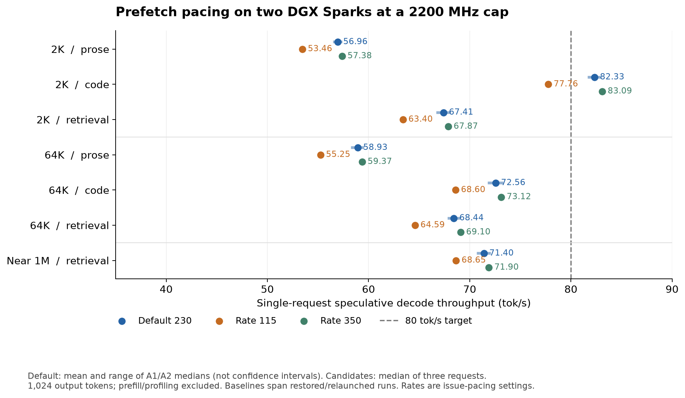
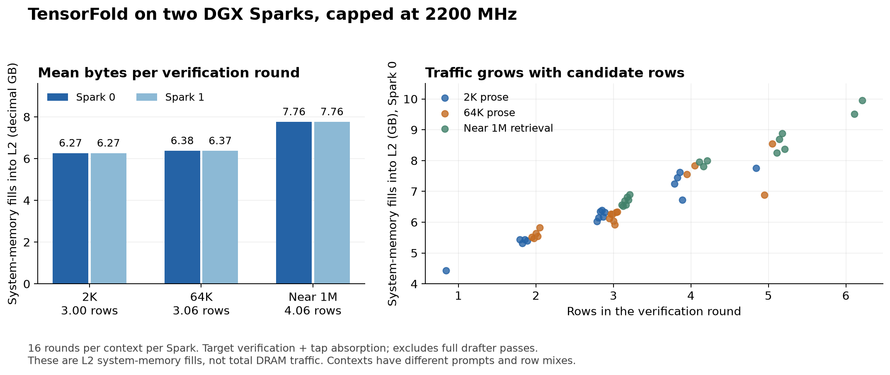

# Verification traffic on two DGX Sparks

The completed hardware-counter experiment measured roughly 6.27, 6.37–6.38, and
7.76 GB of system-memory fills per Spark per verification round at 2K, 64K, and
1,047,040-token prompts. Disabling weight prefetch slowed the tested 2K and 64K
requests. These measurements identify a substantial memory cost, but do not
establish an achieved 80 tok/s result.

Evidence: [screen analysis](screen-analysis.json), [screen receipt](runs/screen/receipt.json.gz),
and [source states](source-state.json). The historical weight-count and standalone
bandwidth calculations are preserved in [roofline basis](evidence/roofline-basis.json).
Source states distinguish the measured
screening build, the later pacing build, and subsequent source validation; a
later source change must not inherit an earlier build's benchmark result.

The `raw_receipt_sha256` and validation input hashes in `source-state.json`
identify the original collected files. Redaction and compression change the
published bytes: use [SHA256SUMS](SHA256SUMS) or the `published_sha256` entries
in [provenance.json](provenance.json) to verify downloaded publication files.
Runtime binary hashes retain their original meaning.

## Optimization decision

**Keep the default prefetch issue rate at 230.** Rate 350 changes aggregate
throughput by only **+0.033% versus the concluding isolated baseline (A2)**
across seven fixtures. The apparent +0.79% gain against the cross-run A1/A2
bracket is comparable to the baseline shift: A2 was 1.15–1.78% faster than A1.
There is no persuasive pacing win, and no 20% decode improvement or 80 tok/s
result across these workloads. The 2K code fixture already exceeded 80 tok/s
before the candidate.

| Context | Final isolated baseline, tok/s | Rate 350, tok/s | Change |
| --- | ---: | ---: | ---: |
| 2K | 68.59 | 68.65 | +0.093% |
| 64K | 66.94 | 66.94 | +0.008% |
| 1,047,040 | 71.95 | 71.90 | -0.074% |

2K and 64K are equal-weight geometric means of prose, code and retrieval
fixture medians; near 1M uses one retrieval fixture. Each median uses three
unprofiled 1,024-token requests. Prefill and the first token are excluded.
These are descriptive sequential-run comparisons, not a significance test.
The rate values control prefetch issue pacing; they are not measured bandwidth.

Rate 115 regressed all seven fixtures by 3.85–6.24% against the bracket.
Disabling all prefetch also regressed the completed screen. The controls remain
available for experiments, while the runtime default and original service
configuration are retained. No model arithmetic or checkpoint weights changed.



## Measurement scope

Both Sparks had a requested GPU clock ceiling of 2200 MHz. The completed screen
record contains 325 samples per device, no missing clock readings or observed
violations, and a maximum observed SM/graphics clock of 2190 MHz on each Spark.
The cap does not imply every measurement ran at exactly 2200 MHz.

The profiler skipped 16 eligible verification rounds and captured the next 16
at each context on each rank: **96 ranges in total**. All ranges used a single
counter pass without workload replay, completed successfully, and matched the
primary-rank trace by exact context position and verification row count. The
counter sample contains no first-round or context-bucket-transition events.

The range contains the target forward pass and DSpark tap absorption. It
excludes prefill, the full MTP draft pass, and target argmax/readback. CUDA/CUPTI
instrumentation can perturb execution; use the separate unprofiled requests for
throughput comparisons. CPU trace timings are not GPU execution times.

The four reported metrics have different meanings:

- `lts__d_sectors_fill_sysmem.sum × 32`: bytes filled into GPU L2 from system memory.
- `lts__t_sectors_aperture_sysmem_op_read.sum × 32`: L2 read-request bytes in the system-memory aperture, including hits.
- `lts__t_sectors_aperture_sysmem_op_write.sum × 32`: L2 write-request bytes in that aperture, not physical DRAM writebacks.
- `gpu__time_duration.sum`: duration of the instrumented GPU range.

These byte counters overlap and must not be added. They do not measure total
physical DRAM traffic, CPU traffic, or complete inference traffic. GB means
decimal 1,000,000,000 bytes throughout.

## Measured traffic and token yield

Each table row averages 16 ranges. The yield is one new target token plus the
accepted draft prefix, before stop/output-budget truncation; it is a potential
emission count, not a count of committed output tokens. The pending input token
was already emitted and is not counted again.

| Prompt tokens | Rank | L2 fills from system memory, GB/round | L2 read requests, GB/round | L2 write requests, GB/round | Potential new tokens/round |
| ---: | ---: | ---: | ---: | ---: | ---: |
| 2,048 | 0 | 6.266 | 7.382 | 0.299 | 1.9375 |
| 2,048 | 1 | 6.265 | 7.394 | 0.299 | 1.9375 |
| 65,536 | 0 | 6.379 | 7.501 | 0.325 | 1.7500 |
| 65,536 | 1 | 6.373 | 7.509 | 0.323 | 1.7500 |
| 1,047,040 | 0 | 7.764 | 9.419 | 0.535 | 3.1250 |
| 1,047,040 | 1 | 7.765 | 9.429 | 0.537 | 3.1250 |



Verification widths vary from one to six rows. More rows can reuse dense
weights and shared expert weights, but also select additional unique experts.
Width alone does not control routing or acceptance. The analysis retains counts,
means and medians separately for each width and rank.

At near 1M, mean fills divided by mean instrumented range time are about
188–190 GB/s per Spark. This is a fill-derived rate, not total memory-bus
utilization. One 2K rank-1 range lasted 120.5 ms; its inclusion depresses that
context's aggregate rate. No cause is established, and it is retained in the
raw evidence. Instrumented range durations are not substituted for decode speed.

## What the earlier 4.33 GB means

The [historical estimate](evidence/roofline-basis.json) is
**4,334,554,816 bytes per Spark**, or 4.33455 GB
(approximately 4.037 GiB), of analytically counted active weights for one plain
token if each relevant weight slice is read once:

```text
2,799,353,536 fixed weight bytes
+ 1,535,201,280 routed expert weight bytes
= 4,334,554,816 bytes per Spark
```

There are 40 layers and six routed experts selected per token per layer, from
384 available experts. Tensor parallelism gives each Spark half the intermediate
dimension of every expert. Both Sparks execute slices of all six selected
experts; the six experts are not divided into three experts per device.

For a multirow verification, the corresponding approximation is:

```text
weight bytes per Spark ≈ fixed weight bytes
                       + sum over layers(unique selected experts × expert-slice bytes)
```

It is not 4.33 GB multiplied by the number of rows: shared matrix operations
reuse weights across rows. Nor is it the resident model size or a measured
per-output-token traffic constant. KV/index scans, activations, cache effects,
repeated reads, communication, and drafter operations require separate treatment.

The measured one-row verification used about 4.43 GB of system-memory fills.
That range came from a draft-enabled request and includes tap absorption, whose
additional weight footprint is about 43.34 MB; it is not a plain-decode counter
measurement. The remaining difference also includes actual traffic outside the
once-through weight model. Logical prefetch touches cannot simply be added to
4.33 GB as extra external reads, because cache hits and useful early loads matter.

## Completed prefetch ablation

The same screening binary ran A1 baseline → all prefetch off → attention-output
prefetch off → A2 baseline. Each unprofiled phase used one warmup, three
speculative repetitions of 1,024 output tokens, and a plain-decode control per
fixture. The baseline below is the arithmetic mean of A1 and A2 median tok/s.
Warmups and all profiled requests are excluded from these speed comparisons.
The client throughput metric is `(output tokens - 1) / (last text arrival - first
text arrival)`; prefill and time to first token are excluded. It is service
throughput for one request at a time, not GPU-only kernel throughput.

| Prose fixture | Baseline tok/s | All prefetch off, tok/s | Change | Attention-output prefetch off, tok/s | Change |
| --- | ---: | ---: | ---: | ---: | ---: |
| 2K | 56.43 | 53.46 | −5.26% | 55.31 | −1.99% |
| 64K | 58.34 | 55.66 | −4.60% | 57.34 | −1.72% |

Plain controls also slowed: all-off by 7.78%/6.70% and attention-output-off by
3.89%/3.44% at 2K/64K. These are diagnostic controls, not independent additional
performance trials. Prefetch removal did not improve these fixtures. This first
screen did not run a near-1M unprofiled ablation and does not decide the outcome
of later prefetch-pacing changes.

All **43 completed request outputs** matched frozen plain-output token prefixes
in the independent comparison: three profiled 512-token outputs and forty
1,024-token outputs across the speed phases, including warmups and controls.
This verifies exact outputs for the tested fixtures; it is not a general model
quality evaluation. The frozen references come from plain decoding on the
previously qualified FP4 branch. The counter/trace parser reproduced all 96 ranges and joins
from the compressed publication files with no issues. Successive partial windows
are accepted only with matching completion records, identities and bounded
process-lifetime counts; malformed or incomplete windows are excluded.

## Interrupted pacing run and isolated continuation

The [interrupted pacing receipt](runs/pacing-interrupted/receipt.json.gz) is
retained as a failed run, including its raw outputs and invalid measurement.
A1 completed all seven fixtures: 35 requests with valid attribution. B115 then
completed 30 valid requests across the six 2K/64K fixtures. Its next request,
the near-1M warmup, produced the correct 1,024 output tokens but failed the
server-metric attribution check:

- Generation counters increased by 1,092 tokens, versus 1,024 expected.
- Two requests finished during the measurement, rather than one.
- Prompt counters increased by 1,049,266 tokens, 2,226 above the expected 1,047,040.

The extra server activity is consistent with an overlapping unrelated request.
The warmup's timing and aggregate server metrics are invalid and excluded from
speed analysis. Its exact token output remains available for accuracy comparison.
All **66 output arrays** matched the frozen plain references; **65 requests**
had valid attribution. Exact output does not make contaminated timing valid.

The controller stopped and restored the original service. This run recorded
481 paired clock samples, no sample errors or ceiling violations, and maximum
observed SM/graphics clocks of 2190 MHz on both Sparks. These restoration and
clock results apply only to that interrupted run.

Against A1 alone, B115's median speculative throughput regressed by 4.6–5.6%
on each of the six completed 2K/64K fixtures. This is an interim comparison,
not the final A1/A2 bracket. The planned B60 phase never ran; it was omitted
from the continuation after those regressions. No B60 performance is claimed.

The [continuation receipt](runs/continuation/receipt.json.gz) records a
completed separate run with a loopback-only benchmark listener. It uses the staged runtime
images and the same benchmark client URL, with both 2200 MHz ceilings retained.
The completed continuation was:

| Phase | Fixtures | Requests | Purpose |
| --- | --- | ---: | --- |
| R115 | Near-1M retrieval only | 5 | Repeat B115's interrupted fixture |
| B350 | All seven fixtures | 35 | Evaluate faster prefetch pacing |
| A2 | All seven fixtures | 35 | Repeat the baseline |

Each fixture contributes one warmup, three speculative repetitions and one
plain-decode control, each requesting 1,024 output tokens. Its completed results and restoration checks are reported below.

The [combined pacing analysis](pacing-analysis.json) explicitly aliases
`R115` to `B115`, preserving each input's basename, decompressed hash, phase and
request lineage, failure and restoration status. Invalid metric rows remain
listed as rejected, including the original warmup; they are not replaced or
silently pooled with valid timings. The failed raw receipt remains archived.

A1 comes from the interrupted run and A2 from the isolated continuation.
Their bracket therefore spans service restoration, relaunch, and listener
isolation. It is composed evidence rather than an uninterrupted single run;
this design cannot isolate drift or every effect of that environmental change.

## Confidence observations

For selected proposals in the three profiled requests, the confidence logits
predict conditional acceptance at each depth. Predicted potential yield is
`1 + sum(prefix products of sigmoid(confidence))`. Observed potential yield is
`1 + accepted prefix length`. First rounds are excluded from this comparison.

| Context | Windows with complete confidence | Predicted yield | Observed yield |
| --- | ---: | ---: | ---: |
| 2K | 263 | 1.944 | 1.939 |
| 64K | 247 | 2.050 | 2.065 |
| Near 1M | 156 | 3.122 | 3.160 |

Six additional near-1M host-copy windows supplied five drafts but no confidence
logits, so they are excluded from the paired comparison. Including their
observed acceptance gives a potential yield of 3.148 across 162 windows.
None of those six windows overlaps the hardware-counter window.

These selected-proposal observations show no obvious aggregate confidence bias
on these requests. They are selection-censored, not held-out calibration data,
and do not demonstrate optimal allocation or the speed of another policy.
Some deeper-depth conditional acceptance cells contain only four or five trials.

## Constraints on an 80 tok/s target

A conditional illustration uses the slower Spark's [earlier standalone read
measurement](evidence/roofline-basis.json), 234.608 GB/s, to service the sampled fills and adds one serial
3.6 ms draft pass per round:

```text
illustrative tok/s = potential tokens per round
                    / (fill GB per round / 234.608 GB/s + 0.0036 s)
```

| Context | Sampled potential yield | Conditional tok/s | Fill reduction needed for 80 at this yield |
| --- | ---: | ---: | ---: |
| 2K | 1.9375 | 63.9 | 22.8% |
| 64K | 1.7500 | 56.9 | 32.7% |
| Near 1M | 3.1250 | 85.2 | None in this simplified calculation |

This illustration assumes the sampled acceptance and routing persist, fills
reach the standalone read rate, and all other computation, communication,
sampling, host gaps, writes and coherence costs vanish. The 3.6 ms draft cost
is an assumption from earlier timing, not measured by these counters. These
figures are neither achieved throughput nor physical hardware speed limits.
Do not sum both ranks' bytes and divide by one rank's bandwidth.

At near 1M, 80 tok/s permits 39.06 ms per sampled round. Optimistic fill service
plus drafting consumes 36.70 ms, leaving only 2.37 ms for every omitted cost.
Its sampled yield of 3.125 agrees reasonably with the full request's 3.148.
The 64K sample's yield of 1.75 is lower than the full request's 2.065, so its
56.9 tok/s illustration is explicitly not a ceiling on that full fixture.

At unchanged fill volume, the simplified short/mid calculations would need
potential yields of approximately 2.42/2.46 to reach 80, before other costs.
Improving useful tokens per byte through better acceptance or less redundant
traffic is therefore a stronger path than assuming scheduling alone can reach
80 across contexts. Aggregate counters do not identify which kernel supplies a
particular read, and close confidence agreement does not imply that recalibrating
confidence alone will improve acceptance. Any candidate still requires exact
output checks and unprofiled throughput measurements on the intended fixtures.

## Next optimization to test

The strongest remaining candidate is the packed EXL3 weight-loading pipeline
for two to six verification rows. The current implementation already batches
dense projections across rows and groups rows that select the same expert;
basic cross-row reuse is present. Aggregate fill counters alone do not show
that any particular kernel reloads weights unnecessarily.

First, record the packed bytes of the unique expert union in an opt-in audit,
using the IDs and member lists already produced by `decode_prep`. Combine that
with fixed projection bytes and measured KV/index traffic to distinguish
compulsory reads from avoidable reloads. Then profile dense and MoE projections
separately and compare copy staging, load scheduling and occupancy at the actual
verification-width distribution. Keep codebook decoding, split-K partitions,
accumulation order and epilogues fixed so loading changes can retain exact output.

The relevant implementations are `zig/src/families/dsv41/exl3_experts.zig`
(`decode_prep` and expert launch setup) and `exl3_linear.zig` (multirow dense
projections). The expert path currently uses four warps and three copy stages;
adding stages can cost occupancy, so a larger pipeline is not automatically
faster. This is a proposed follow-up, not an implemented or measured speedup.

## Completed pacing results

Three measured speculative repetitions and one plain control per fixture/phase; warmups are excluded. A1/A2 brackets span restoration, relaunch and listener isolation as described above.

| Fixture | Baseline tok/s | B115 tok/s | Change | B350 tok/s | Change |
| --- | ---: | ---: | ---: | ---: | ---: |
| holdout-code-2048-7391 | 82.33 | 77.76 | -5.56% | 83.09 | +0.92% |
| holdout-code-65536-7391 | 72.56 | 68.60 | -5.46% | 73.12 | +0.77% |
| holdout-prose-2048-7391 | 56.96 | 53.46 | -6.14% | 57.38 | +0.75% |
| holdout-prose-65536-7391 | 58.93 | 55.25 | -6.24% | 59.37 | +0.75% |
| holdout-retrieval-1047040-7391 | 71.40 | 68.65 | -3.85% | 71.90 | +0.70% |
| holdout-retrieval-2048-7391 | 67.41 | 63.40 | -5.95% | 67.87 | +0.69% |
| holdout-retrieval-65536-7391 | 68.44 | 64.59 | -5.62% | 69.10 | +0.98% |

See [numeric summary](summary.json) and [combined pacing analysis](pacing-analysis.json) for fixture and context aggregates. All 141 token arrays matched the frozen plain reference; one interrupted warmup has invalid timing attribution. B60 was not run. The original rate-230 default is retained.

The two baseline measurements are also shown separately. A small gain against their average can be comparable to baseline drift; it does not by itself establish a causal speedup.

| Fixture | A1 tok/s | A2 tok/s | Baseline drift | B350 versus A2 |
| --- | ---: | ---: | ---: | ---: |
| holdout-code-2048-7391 | 81.81 | 82.86 | +1.28% | +0.29% |
| holdout-code-65536-7391 | 71.92 | 73.19 | +1.77% | -0.10% |
| holdout-prose-2048-7391 | 56.63 | 57.28 | +1.15% | +0.17% |
| holdout-prose-65536-7391 | 58.41 | 59.45 | +1.78% | -0.13% |
| holdout-retrieval-1047040-7391 | 70.85 | 71.95 | +1.56% | -0.07% |
| holdout-retrieval-2048-7391 | 66.82 | 67.99 | +1.75% | -0.18% |
| holdout-retrieval-65536-7391 | 67.95 | 68.93 | +1.44% | +0.26% |

## Final validation and restoration

The isolated continuation completed all 75 requests and restored the original service. All three run clock logs passed the 2200 MHz checks. Their sample counts and maxima appear in [summary.json](summary.json).

Later source `9be95dd3b75b4cf5495bc814284b42d211431a13` completed the recorded CPU compilation/host-test jobs and normal/abort smoke checks. These validation results do not turn the later source into the binary measured by the performance matrices. See [CPU validation](evidence/final-cpu-validation.json), [source manifest](evidence/final-source-manifest.json), and [smoke receipt](evidence/final-smoke.json). Build logs retain warnings and expected fault-injection diagnostics; the lean check reports 1,489 inherited findings, not a clean pass.

Validation completed **248 host tests, four standalone policy tests, 16 analyzer
tests, the native server and collector builds, and normal/abort GPU probes**.
All 184 completed output arrays across the screen and pacing runs matched the
frozen reference: 186,880 compared tokens. The invalid warmup remains excluded
from timing. The three clock logs contain 1,401 paired samples, zero errors or
observed cap violations, and a maximum of 2190 MHz on each Spark. Both 2200 MHz
ceilings were retained after restoring the original service.

The optional collector is loaded only when explicitly configured. The final
normal probe recorded four valid single-pass ranges; the active-window abort
probe discarded its buffered records and disabled further collection. These
checks validate profiler behavior on GB10; other GPU architectures and Metal
were not qualified here.
